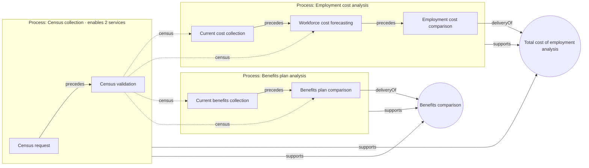

# Sales assembly 0.3.0 and Sales value map 0.1.0

The Sales domain assembled from components (design decisions D17–D24). The Sales vocabulary, taxonomy and ontology (`../ttl/`) are the parts catalog and the joining rules. The files here are the components: instance graphs typed by those classes and classified by those concepts.

There are two separate assemblies (D24):

- **Sales assembly 0.3.0** is Service › Process › Process step. A service is enabled by one or more processes, a process is built from process steps, and every step carries its SIPOCM (supplier, input, process step, output, customer, measure) in terms of the core ontology. It does not refer to the buyer personas.
- **Sales value map 0.1.0** bridges the Sales assembly to the PEO buyer persona graph: which job steps each selling step addresses, and what each service delivers today against the desired outcomes. It is shown on its own page (Value Mapping, to come), not on Service Assembly.

## Components

| Release | Tier | File (`ttl/`, `trig/`) | Named graph |
|---|---|---|---|
| Sales assembly | Party graph | `party-graph-domain-sales-sales-parties-0.1.0` | `…/resource/domain-sales/party-graph/sales-parties/` |
| Sales assembly | Step graphs (7) | `step-graph-domain-sales-<step>-<version>` | `…/resource/domain-sales/step-graph/<step>/` |
| Sales assembly | Process graphs (3) | `process-graph-domain-sales-{census-collection, employment-cost-analysis, benefits-plan-analysis}-0.1.0` | `…/resource/domain-sales/process-graph/<process>/` |
| Sales assembly | Service graphs (2) | `service-graph-domain-sales-{total-cost-of-employment-analysis, benefits-comparison}-0.2.0` | `…/resource/domain-sales/service-graph/<service>/` |
| Sales assembly | Manifest | `manifest-domain-sales-0.3.0` | `…/resource/domain-sales/manifest/0.3.0/` |
| Sales value map | Persona graph (container) | `../../commercial-operations/assembly/…/persona-graph-domain-commercial-operations-peo-buyer-personas-0.1.0` | `…/resource/domain-commercial-operations/persona-graph/peo-buyer-personas/` |
| Sales value map | Value map | `value-map-domain-sales-sales-buyer-value-0.1.0` | `…/resource/domain-sales/value-map/sales-buyer-value/` |
| Sales value map | Manifest | `manifest-domain-sales-value-map-0.1.0` | `…/resource/domain-sales/manifest/value-map-0.1.0/` |

The 0.2.0 components that 0.3.0 replaced (the standard selling process graph, the census collection step graph, the older step and service graphs and the 0.2.0 manifest) are in `../../archive/superseded-assembly-0.3.0/`. `graphdb-load.command` removes them from GraphDB too, after backing them up.

## How the services are assembled

Joins: a process `core:supports` the service it enables; a process `core:hasStep` its steps, ordered by `core:precedes`; the step that hands the service over is its `core:deliveryOf`.

## SIPOCM of a step

| | Relation | Example: census validation |
|---|---|---|
| **S** Supplier | derived: whoever performs the step that produces an input; outside the assembly, `commercialops:hasSupplier` | Prospect role (outside) |
| **I** Input | `core:consumes` | Census |
| **P** Process step | the step, `core:performedBy`, `core:fulfillsRole` | Census validation, by the sales advisor agent |
| **O** Output | `core:produces` | Census (validated), census validation report |
| **C** Customer | derived: whoever performs the step that consumes an output; outside the assembly, `commercialops:hasCustomer` | Prospect role (outside); current cost collection, workforce cost forecasting, current benefits collection, benefits plan comparison |
| **M** Measure | `core:measuredBy` | Census validation failure rate (% of censuses, minimize) |

Has supplier and has customer are new in the Commercial Operations container 0.3.0. They specialize RO *has participant* and are candidates for promotion to the core.

## Results

From `assembly-report.md`:

- **Checks:** 0 errors. All 35 node shapes ran over the Sales assembly, and again over the assembly with the value map. There are 42 warnings, all of the three known kinds: core `process-shape` firing on process steps, core `asset-shape` expecting a lifecycle on every asset, and the census shape expecting persons (open question 16).
- **Assembly index (modeled pathway):** total cost of employment analysis takes 77 joins (110 without reuse); benefits comparison takes 65 (91). Assembled together they take 115 joins instead of 142, a 19% saving.
- **Copy number:** the census collection process, with its two steps, enables both services and is the first platform candidate.
- **Value map:** 4 measured value gaps, 0 met, 20 not yet measured (`value-gaps.csv`): quote time 16 days against 10; census failures 38% against 10% (once in each service); plan comparison 34 minutes against 20.

## View it

After `graphdb-load.command`, open **Service Assembly** in the KE Workbench (`tools/service-assembly.html`) and pick *Sales assembly 0.3.0*: each service with the processes that enable it, their steps in order, the SIPOCM table, where each process and step is reused, the shapes for each service, and coverage of processes and steps by service.

## Add a service

1. Add the service kind, and any new process, step or record kinds, to `_build/spec_sales.py`. Add primitives only where the core and the container lack them. Then run `python3 _build/build_domains.py --only sales`.
2. In `_build/assembly_sales.py`, add the steps that don't exist yet to `STEPS` (with their SIPOCM), the processes to `PROCESSES`, and the service to `SERVICES` with its delivery step and enabling processes. Reuse existing processes and steps by name; never copy them. Add the job steps each new step addresses to `ADDRESSES` (value map).
3. Run `python3 _build/build_assembly.py`. It rebuilds the graphs and both manifests, moves superseded components to the archive, runs the checks and shapes, and refreshes the measures and value gaps. It exits with an error if any check fails.
4. Run `graphdb-load.command` to replace the Sales graphs in GraphDB.
